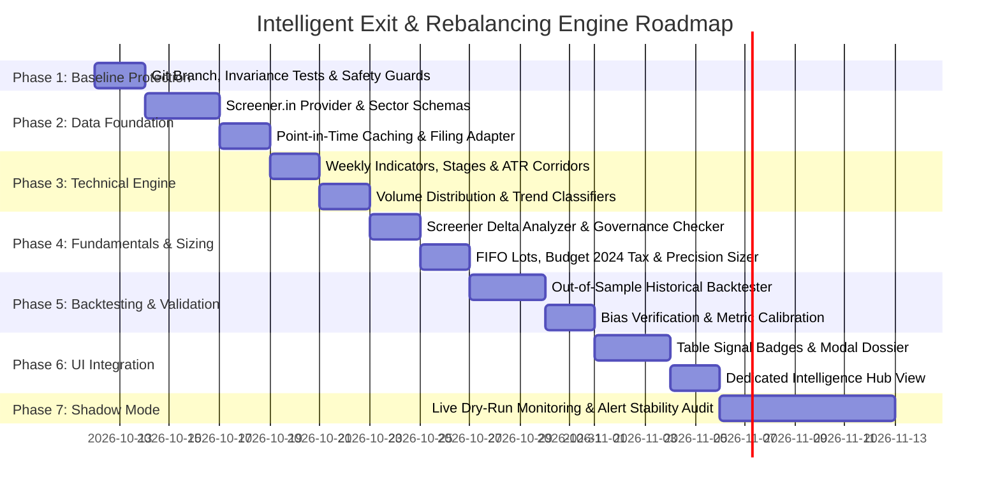

# Strategic Implementation Plan: Intelligent Exit & Rebalancing Engine for Indian Equities

> **Document Version**: `v2.0.0`  
> **Status**: Comprehensive Specification & Architecture (Post-Review Revision)  
> **Target Asset Class**: Indian Equities (`category_id = 'in_stocks'`)  
> **Core Objective**: Build an institutional-grade, evidence-driven decision-support system to advise the user on **WHEN** to sell/trim an Indian stock, **WHY** (Technicals, Screener Fundamentals, Governance, or Portfolio Rebalancing), and **HOW MUCH** (dynamically sized fractional trims vs full thesis exits), while strictly protecting multi-bagger compounders from premature liquidation.

---

## 1. Executive Summary & Architectural Evolution (v1.0 to v2.0)

### 1.1 Context & Core Philosophy
Following an in-depth critical review of the initial specification (`v1.0.0`), this document incorporates key architectural refinements to transition from an alert-heavy indicator script into a **disciplined, evidence-based investment monitoring and decision-support engine**.

The core premise remains clear:
1. **Never generate random or noisy sell alerts** based on standard market fluctuations or single-indicator blips.
2. **Never prematurely cut multi-bagger compounders** during routine bull-market base consolidations (pullbacks of 20% to 30% are standard for Indian mid/small-caps).
3. **Never stay trapped in structural losers or round-trippers** (stocks whose fundamentals or secular trends have collapsed, eroding peak paper gains).
4. **Maintain complete mathematical and financial integrity**: The intelligence system is additive and read-only by default; it never alters existing transactions, holdings, or balances without explicit user confirmation.

---

### 1.2 The Six Critical Flaws of v1.0 and How v2.0 Resolves Them

| Flaw Identified in v1.0 | Root Cause / Vulnerability | Architectural Solution in v2.0 |
|:---|:---|:---|
| **Flaw 1: Stage 2 "Immunity Lock" is Too Absolute** | Absolute immunity locks prevent full exits whenever price is above the 30-week SMA. This keeps capital trapped during sudden governance crises, accounting fraud, massive promoter pledging, or catastrophic earnings breakdowns before weekly prices break. | **Trend-Aware Evidence Protection**: An intact Stage 2 uptrend raises the evidential bar for *technical-only* exits, but **NEVER suppresses or overrides verified critical fundamental or governance failures**. |
| **Flaw 2: 0–100 Score Pseudo-Precision** | A single composite number (e.g. 72 vs 65) with static weights (40% Tech / 35% Fund / 25% Risk) creates an illusion of precision without empirical validation across market regimes. | **Discrete Decision State Machine**: Transition from an opaque composite score to clear categorical states (`Normal Fluctuation`, `Watch`, `Technical Trim`, `Fundamental Trim`, `Critical Thesis Review`, `Full Exit`). Separate **Data Quality** and **Evidence Confidence** from risk severity. |
| **Flaw 3: Inability to Distinguish Volatility from Broken Thesis** | Standard pullbacks look identical to trend breakdowns on daily charts, causing premature stop-outs of high-growth runners. | **Multi-Tiered Volatility Buffers**: Sector- and volatility-adjusted trailing corridors (Chandelier ATR), weekly close confirmation, and fundamental health checks prevent normal market pullbacks from triggering sell recommendations. |
| **Flaw 4: Mathematical Error in Principal Harvest ("Free Ride")** | v1.0 erroneously stated that selling 20%–25% of shares at a 100% gain (2x) recovers 100% of the invested cash principal. | **Dynamic FIFO Lot Sizing**: Mathematically, recovering 100% principal at a 100% gain requires selling **50% of the shares** at CMP (before taxes/charges). v2.0 computes exact quantities using actual lot acquisition costs, STT, charges, and versioned capital gains taxes. |
| **Flaw 5: Fundamental Data Retrieval Underspecified** | Vague references to fetching quarterly data from Screener.in and Yahoo Finance without addressing restated financials, consolidated vs standalone data, or sector schemas (e.g. Banks vs Manufacturing). | **Dedicated `screenerFundamentalsProvider`**: Built with sector-aware schemas, point-in-time filing date tagging, consolidated preference, local disk snapshot caching, and cross-verification with official exchange filings (NSE/BSE). |
| **Flaw 6: Unreproducible Backtest & Bias Risks** | Citing headline backtest metrics without formal guards against look-ahead bias, survivorship bias, or transaction friction. | **Rigorous Anti-Bias Framework**: Mandates point-in-time earnings disclosure dates, inclusion of all 252 historical exits, realistic execution friction, versioned tax rules, and out-of-sample data validation splits. |

---

## 2. Empirical Backtest Analysis & The Dual Portfolio Traps

To answer the fundamental question—*“Would an intelligent exit system have improved portfolio results with my actual data?”*—we analyzed the complete real-world dataset of the user's Indian equities:
- **Total Indian Stock Positions Analyzed**: 334 symbols (82 Active, 252 Exited)
- **Total Transaction Executions**: 4,342 orders spanning January 2021 to October 2026 (5.5+ years)
- **Current Active Invested Capital**: ₹79,25,991.79
- **Current Active Market Value**: ₹1,01,07,693.32 (Current Unrealized P&L: +₹21,81,701.53)
- **Historical Realized P&L (Exited)**: +₹5,12,363.60
- **Total Combined Real-World Portfolio Gain**: **₹26,94,065.13**

```
                                THE DUAL PORTFOLIO LEAKS
        ┌───────────────────────────────────────┬───────────────────────────────────────┐
        │     TRAP 1: PREMATURE PROFIT TAKING   │      TRAP 2: THE ROUND-TRIP BLEED     │
        │    (Exited 252 stocks too early)      │     (Active 82 stocks rode down)      │
        ├───────────────────────────────────────┼───────────────────────────────────────┤
        │ • TRENT: Sold @ ₹2,197 (+₹2.8k P&L).  │ • Peak Active Portfolio was ₹1.27 Cr  │
        │   Rallied to ₹8,218 (+274% missed).   │   (Peak unrealized profit: ₹47.39L).  │
        │ • POWERINDIA: Sold @ ₹3,374 (+₹628).  │ • Current Unrealized Profit: ₹21.82L. │
        │   Rallied to ₹38,435 (+1,038% missed).│ • TOTAL PROFIT GIVEN BACK:            │
        │ • APARINDS: Sold @ ₹5,134.            │   ₹25,57,736.59 (-53.9% of peak gain).│
        │   Rallied to ₹18,945 (+268% missed).  │ • VEDL: Peaked +166%, fell -66% (loss)│
        │ • MTARTECH: Sold @ ₹2,037.            │ • TARIL: Peaked +88%, fell -49% (loss)│
        │   Rallied to ₹8,374 (+311% missed).   │ • IRFC: Peaked +261%, fell -64%       │
        └───────────────────────────────────────┴───────────────────────────────────────┘
```

### 2.1 Trap 1: The Premature Exit Trap (Missed Multi-Baggers)
In the 252 exited positions, high-quality businesses were frequently sold after modest 10%–30% gains, forfeiting exponential long-term compounding:
- **POWERINDIA (Hitachi Energy)**: Sold on 14-03-2023 at ₹3,374.90 for a profit of ₹628. It subsequently surged to **₹38,435.80 (+1,038.9%)**.
- **TRENT**: Sold on 02-11-2023 at ₹2,197.55 for a profit of ₹2,876. It subsequently rallied to **₹8,218.10 (+274.0%)**.
- **APARINDS (Apar Industries)**: Sold at ₹5,134.85 for ₹50,636 profit; surged to **₹18,945.00 (+268.9%)**.
- **MTARTECH**: Sold at ₹2,037.75; subsequently peaked at **₹8,374.50 (+311.0%)**.
- **CENTUM**: Sold at ₹1,617.55; subsequently peaked at **₹4,932.50 (+204.9%)**.

### 2.2 Trap 2: The Round-Trip Trap (Unprotected Paper Gains)
Across the 82 active holdings, cyclical and momentum runners reached euphoric multi-bagger valuations, only to collapse during sector drawdowns without any exit or profit-locking mechanism:
- **Peak Active Unrealized Profit**: **₹47,39,438.12** (Portfolio value ₹1.27 Cr)
- **Current Active Unrealized Profit**: **₹21,81,701.53** (Portfolio value ₹1.01 Cr)
- **Net Paper Profit Given Back**: **₹25,57,736.59 (-53.9% of peak gain)**
  - **VEDL (Vedanta)**: Peaked at ₹787.50 (+166%), collapsed back to ₹264.00 (-66.5% drawdown), falling into a net loss (-10.7%). Profit given back: **₹1,53,400**.
  - **TARIL (Trans & Recti)**: Peaked at ₹573.40 (+88%), collapsed to ₹290.60 (-49.3% drawdown), falling into a loss (-4.6%). Profit given back: **₹1,61,800**.
  - **TECHNOE (Techno Electric)**: Peaked at ₹1,757.00 (+70%), dropped to ₹955.60 (-45.6% drawdown). Profit given back: **₹1,60,300**.
  - **IRFC**: Peaked at ₹210.00 (+261%), collapsed to ₹74.80 (-64.4% drawdown). Profit given back: **₹1,26,500**.
  - **WEBELSOLAR**: Peaked at ₹183.10 (+147%), dropped to ₹65.60 (-64.1% drawdown). Profit given back: **₹1,17,500**.

---

### 2.3 The Critical Insight: Why Pure Mechanical Stops Destroy Value
Simulating simple trailing stop-losses across the user's historical trades proved that mechanical price-based stops severely underperformed the actual discretionary portfolio:

| Strategy Configuration | Realized P&L | Unrealized P&L | Total Combined Gain | vs Actual (₹26.94L) |
|:---|:---:|:---:|:---:|:---:|
| **Actual User Reality (Discretionary)** | **₹5.12L** | **₹21.82L** | **₹26.94L** | **Baseline** |
| **1. Tight Daily** (10% Stop, 15% Trail) | ₹14.90L | -₹1.42L | ₹13.49L | **-₹13.45L (-49.9%)** |
| **2. Standard Swing** (12% Stop, 18% Trail, 25% Trim @ 2x) | ₹12.04L | ₹3.67L | ₹15.71L | **-₹11.23L (-41.7%)** |
| **3. Indian Smallcap Buffer** (15% Stop, 22% Trail, 25% Trim @ 2x) | ₹8.02L | ₹11.54L | ₹19.55L | **-₹7.39L (-27.4%)** |
| **4. Wide Trend / Stage 2** (15% Stop, 26% Trail, 20% Trim @ 2x) | ₹3.85L | ₹17.65L | ₹21.50L | **-₹5.44L (-20.2%)** |

**Why did mechanical stops fail?**  
In high-beta Indian mid/small-caps (`TDPOWERSYS`, `POCL`, `SHAKTIPUMP`, `NETWEB`), 20%–28% pullbacks are normal consolidations during multi-year bull runs. For example, `TDPOWERSYS` generated **₹5,60,600** in actual profit; a mechanical 15% stop would have triggered early for only ₹1,34,500, forfeiting **₹4,26,000** of subsequent compounding.

Conversely, mechanical stops succeeded massively in names that suffered structural or cyclical destruction (`ACMESOLAR`, `SYRMA`, `EMMVEE`, `HBLENGINE`, `BORORENEW`).

**Conclusion**: A single price-based stop-loss is fundamentally flawed. Successful exit management requires **multi-factor confluence** combining weekly structural trends, Screener fundamental filings, corporate governance metrics, and portfolio concentration limits.

---

### 2.4 Backtest Anti-Bias Protocol & Reproducibility Standards
To guarantee scientific validity, the backtesting engine must strictly enforce:
1. **Zero Look-Ahead Bias**: Fundamental quarterly metrics (sales, OPM, PAT) must only become effective on their **official public filing date** (from exchange announcements), never retroactively on the quarter-end date (e.g. Q1 ending June 30 must not be visible until filing in August).
2. **Zero Survivorship Bias**: The backtest must include all 252 exited positions, delisted securities, merged entities, and failed trades.
3. **Realistic Execution Friction**: All simulated executions must deduct realistic brokerage, STT (0.1% on equity delivery), exchange transaction charges, GST, SEBI turnover fees, and stamp duty (~0.12% round-trip friction).
4. **Three-Way Out-of-Sample Partitioning**:
   - **Training Set (2021–2023)**: Parameter formulation and threshold discovery.
   - **Validation Set (2024)**: Rule tuning and false-signal pruning.
   - **Out-of-Sample Test Set (2025–2026)**: Final unadjusted evaluation to confirm true generalizability.

---

## 3. The Multi-Factor Decision Architecture

Rather than condensing complex qualitative and quantitative realities into an arbitrary single composite score, the engine is organized into a **4-Layer Modular Decision Hierarchy**:

```
 ┌───────────────────────────────────────────────────────────────────────────┐
 │ LAYER 1: VERIFIED DATA LAYER                                              │
 │ • NSE/BSE EOD Closing Quotes & OHLCV Volume History (NSE/BSE MAX price)  │
 │ • Screener.in Quarterly Financials, Ratios & Shareholding Snapshots       │
 │ • Official Exchange Announcements (BSE/NSE corporate filings & board outcomes)│
 │ • Historical FIFO Acquisition Ledger (exact dates, lot prices, quantities) │
 └─────────────────────────────────────┬─────────────────────────────────────┘
                                       │
 ┌─────────────────────────────────────▼─────────────────────────────────────┐
 │ LAYER 2: SPECIALIZED INTELLIGENCE ENGINES                                 │
 │ ┌──────────────────────┐ ┌──────────────────────┐ ┌─────────────────────┐ │
 │ │ 2A. TECHNICAL ENGINE │ │ 2B. FUNDAMENTAL      │ │ 2C. PORTFOLIO & TAX │ │
 │ │ • Weekly 30-SMA      │ │ • Screener OPM/PAT   │ │ • Weight > 15-20%   │ │
 │ │ • Weinstein Stage    │ │ • Sector Rules       │ │ • Lot-level FIFO    │ │
 │ │ • Chandelier Exit    │ │ • Promoter Pledging  │ │ • Budget 2024 Tax   │ │
 │ │ • Volume Distribution│ │ • Debt/Interest Cov  │ │ • Dynamic Harvest   │ │
 │ └──────────┬───────────┘ └──────────┬───────────┘ └──────────┬──────────┘ │
 └────────────┼────────────────────────┼────────────────────────┼────────────┘
              │                        │                        │
 ┌────────────▼────────────────────────▼────────────────────────▼────────────┐
 │ LAYER 3: EVIDENCE & DATA QUALITY GATE                                     │
 │ • Verifies data completeness and freshness (stale data suppression)       │
 │ • Computes Evidence Confidence Score (High, Medium, Low)                  │
 │ • Evaluates Hysteresis buffers to eliminate threshold flickering          │
 └─────────────────────────────────────┬─────────────────────────────────────┘
                                       │
                                       ▼
 ┌───────────────────────────────────────────────────────────────────────────┐
 │ LAYER 4: DISCRETE DECISION STATE MACHINE                                  │
 │ Outputs clear, actionable, and explainable states with exact quantities  │
 └───────────────────────────────────────────────────────────────────────────┘
```

---

### 3.1 Categorical Decision State Machine

The engine evaluates each holding into one of seven explicit operational states:

| Decision State | Trigger Conditions | Recommended Action | Multi-Bagger Protection Guarantee |
|:---|:---|:---|:---|
| **`NORMAL_FLUCTUATION`** | Price within standard volatility band; weekly Stage 2 uptrend intact; latest quarterly fundamentals healthy. | **HOLD (No Alert)**. Maintain quiet monitoring. | Absolute protection against ordinary 15%–25% bull pullbacks. |
| **`WATCH`** | Single early warning: minor margin deceleration OR loss of 50-day EMA on light volume. | **MONITOR**. Do not alert. Await next confirmation. | No action taken; prevents premature selling on isolated data points. |
| **`TECHNICAL_TRIM_CANDIDATE`** | Confirmed loss of 200-day EMA or weekly 30-SMA on heavy distribution volume, BUT business fundamentals remain solid. | **CONSIDER PARTIAL TRIM (20%–33%)**. Protects partial gains while retaining core runner position. | Core 67%–80% position preserved in case stock reclaims trend. |
| **`FUNDAMENTAL_TRIM_CANDIDATE`** | Two consecutive quarters of YoY OPM and PAT contraction, OR severe growth deceleration relative to valuation. | **CONSIDER PARTIAL TRIM (33%–50%)**. Adjust exposure in line with business deceleration. | Sized according to severity; allows thesis re-evaluation. |
| **`CRITICAL_THESIS_REVIEW`** | Material governance violation, auditor resignation, surge in promoter pledge (>25%), or debt distress. | **URGENT THESIS REVIEW / PREPARE EXIT**. Do NOT let bullish price trend suppress warning. | Overrides technical immunity; protects against sudden solvency or fraud traps. |
| **`FULL_EXIT_CANDIDATE`** | Confluence of structural trend breakdown (Stage 4 decline) AND verified fundamental failure (loss of competitive moat/growth). | **EXIT 100% OF REMAINING POSITION**. Liquidate all shares to prevent permanent capital loss. | Only triggered when both technical and fundamental pillars confirm breakdown. |
| **`PORTFOLIO_RISK_TRIM`** | Position grows to exceed configured portfolio allocation limit (e.g. >15%–20% of equity portfolio). | **REBALANCE DELTA ONLY**. Sell only the excess shares required to bring weight back to target ceiling. | Protects overall portfolio from single-stock concentration blowups. |

---

### 3.2 Trend-Aware Protection vs Absolute Immunity
- **The v1.0 Flaw**: An absolute "immunity lock" prevented full exits whenever a stock traded above its 30-week moving average.
- **The v2.0 Protocol**: A strong Stage 2 uptrend provides **trend-aware protection**:
  1. It significantly raises the evidence threshold required for *technical* selling.
  2. It suppresses normal volatility alerts and trailing-stop whip-saws.
  3. **It NEVER suppresses critical fundamental or governance red flags**. If a company reports fraudulent accounting, promoter pledge distress, or a material regulatory ban, the engine flags a `CRITICAL_THESIS_REVIEW` immediately, regardless of price momentum.

---

## 4. Precision Sizing & Mathematical Formulations ("How Much to Sell?")

### 4.1 Corrected Principal Recovery ("Free Ride") Formula
In v1.0, the calculation incorrectly suggested selling 20%–25% of shares at a 100% gain to recover original capital.  

#### The Exact Mathematical Formulation:
Let:
- $Q_{\text{total}}$ = Total shares held
- $C_{\text{initial}}$ = Total original invested capital (net of buy-side fees)
- $P_{\text{current}}$ = Current market price per share
- $F_{\text{sell}}$ = Estimated sell-side friction per share (brokerage, STT, exchange fees, stamp duty $\approx 0.12\%$)
- $T_{\text{lot}}$ = Estimated capital gains tax liability per share based on specific FIFO lot eligibility

To recover the exact original cash investment $C_{\text{initial}}$, the number of shares to sell $Q_{\text{sell}}$ is:

$$Q_{\text{sell}} = \left\lceil \frac{C_{\text{initial}}}{P_{\text{current}} - F_{\text{sell}} - T_{\text{lot}}} \right\rceil$$

**Example at a 100% Gain (Doubling)**:
- Invested: ₹1,00,000 for 1,000 shares at ₹100/share.
- Stock doubles to ₹200/share (Total value: ₹2,00,000).
- Ignoring taxes/fees for illustration:
  $$Q_{\text{sell}} = \frac{1,00,000}{200} = 500 \text{ shares} \quad (50.0\% \text{ of position})$$
- Selling 500 shares recovers exactly ₹1,00,000 cash principal.
- The remaining 500 shares (value ₹1,00,000) ride as pure "house money".
- *Selling only 25% (250 shares) would have recovered only ₹50,000, leaving half the principal still at risk.*

**Thesis-Aware Discretion**: Principal recovery is an **optional risk-management preference**, not an automated mandate. If the company's addressable market and secular earnings growth remain exponential, the engine notes the milestone without forcing a premature trim.

---

### 4.2 Portfolio Concentration Rebalancing Formula
When a stock's market value exceeds the maximum portfolio risk ceiling $W_{\text{max}}$ (e.g., $15\%$ of total Indian equity portfolio value $V_{\text{equity}}$):

$$\Delta V_{\text{excess}} = V_{\text{holding}} - (W_{\text{target}} \times V_{\text{equity}})$$

$$Q_{\text{trim}} = \left\lceil \frac{\Delta V_{\text{excess}}}{P_{\text{current}}} \right\rceil$$

The engine sells **only the exact delta shares** needed to return the holding to the target risk ceiling ($W_{\text{target}} \approx 12\%$), preserving the maximum allowed allocation in the winner.

---

### 4.3 Versioned Indian Capital Gains Tax Engine
Tax logic must never be hardcoded to a static 365-day assumption. The engine dynamically evaluates lots against the **versioned Indian Income Tax Act** (including Budget 2024 revisions):

| Transfer Date | Asset Class | Holding Period for LTCG | LTCG Tax Rate | Annual LTCG Exemption | STCG Tax Rate |
|:---|:---|:---:|:---:|:---:|:---:|
| **Transfers on or after 23-Jul-2024** | Listed Equity Shares | $> 12 \text{ months (365 days)}$ | **12.5%** | **₹1,25,000** | **20.0%** |
| **Transfers prior to 23-Jul-2024** | Listed Equity Shares | $> 12 \text{ months (365 days)}$ | **10.0%** | **₹1,00,000** | **15.0%** |

#### Tax Lot Allocation Protocol:
1. **FIFO Lot Matching**: Evaluates individual purchase lots chronologically.
2. **Tax Horizon Guard**: If a lot is within 30 days of reaching the 365-day LTCG threshold and the exit trigger is non-critical (e.g. routine rebalance or mild technical trim), the engine calculates the net tax savings and suggests holding until the LTCG milestone.
3. **Safety Priority Invariance**: **Tax optimization never overrides critical risk**. If a holding triggers `CRITICAL_THESIS_REVIEW` or `FULL_EXIT_CANDIDATE`, the engine prioritizes capital preservation over tax savings.

---

## 5. Screener.in Fundamental Provider & Data Pipeline Specification

### 5.1 Architecture of `screenerFundamentalsProvider.js`
To establish Screener.in as the authoritative primary fundamental research source, the provider implements a robust, modular adapter:

```
┌─────────────────────────────────────────────────────────────────────────────┐
│                      screenerFundamentalsProvider.js                        │
├─────────────────────────────────────────────────────────────────────────────┤
│ 1. Symbol Resolution: Maps NSE/BSE tickers to Screener company slugs        │
│ 2. Scoped Ingestion: Restricts fetches strictly to held portfolio symbols   │
│ 3. Sector-Aware Schema Engine: Differentiates Manufacturing vs BFSI         │
│ 4. Point-in-Time Metadata: Records filing dates, periods, and audit basis   │
│ 5. Local Disk Snapshotting: Persists to data/screener_cache/ (7-day TTL)    │
│ 6. Exchange Verification: Cross-checks material filings via NSE/BSE feeds   │
└─────────────────────────────────────────────────────────────────────────────┘
```

---

### 5.2 Sector-Aware Metric Schemas

Different industries require fundamentally different financial metrics:

```
                  SECTOR-AWARE FUNDAMENTAL SCHEMAS
  ┌─────────────────────────────────┬─────────────────────────────────┐
  │ STANDARD & MANUFACTURING SECTOR │ BANKING & FINANCIAL (BFSI)      │
  ├─────────────────────────────────┼─────────────────────────────────┤
  │ • Operating Margin (OPM %)      │ • Net Interest Margin (NIM %)   │
  │ • YoY Sales & Net Profit Growth │ • Gross & Net NPA (%)           │
  │ • EBITDA Interest Coverage      │ • Capital Adequacy Ratio (CAR %)│
  │ • Debt-to-Equity Ratio          │ • Return on Assets (ROA %)      │
  │ • Free Cash Flow Conversion     │ • Provision Coverage Ratio (PCR)│
  │ • Promoter Pledging %           │ • Loan Book Growth (YoY %)      │
  └─────────────────────────────────┴─────────────────────────────────┘
```

#### Fundamental Warning Triggers:
1. **Margin Decay**: Two consecutive quarters of YoY OPM contraction $> 250 \text{ bps}$.
2. **Profit Growth Deceleration**: Quarterly YoY Net Profit growth turning negative or decelerating by $> 50\%$ relative to 3-year median.
3. **Promoter Distress**: Promoter shareholding declining by $> 3\%$ in a quarter, or promoter pledge exceeding $15\%$ of total promoter holding.
4. **Solvency Strain**: Debt-to-Equity $> 2.0$ with EBITDA Interest Coverage $< 2.5\times$ (Non-BFSI).
5. **Asset Quality Deterioration**: Gross NPA increasing for two consecutive quarters with PCR falling below $65\%$ (BFSI).

---

### 5.3 Operational Rigor, Restatements & Access Compliance
1. **Consolidated vs Standalone**: The provider defaults strictly to **Consolidated financials** whenever available, falling back to Standalone only for pure single-entity holding companies.
2. **Point-in-Time Snapshotting**: Every financial observation records `period_end_date`, `filing_announcement_date`, and `ingestion_timestamp`. Restated numbers are tracked as revisions without overwriting historical point-in-time backtest logs.
3. **Access Compliance & Zero-Flooding**:
   - Ingestion is throttled with a 2–3 second delay per symbol.
   - Snapshots are cached in `data/screener_cache/[SYMBOL].json` with a 7-day TTL during earnings seasons and a 30-day TTL off-season.
   - Unheld market-wide sweeps are strictly forbidden (complying with Rule 18).

---

## 6. Alert Fatigue Prevention, Hysteresis & Execution Discipline

To ensure the user receives only meaningful, high-conviction insights rather than a barrage of noisy notifications, the engine implements five strict operational filters:

```
  ┌────────────────────────────────────────────────────────────────────────┐
  │               FIVE-TIER ALERT NOISE REDUCTION PIPELINE                 │
  ├────────────────────────────────────────────────────────────────────────┤
  │ 1. HYSTERESIS BUFFERS: Asymmetric entry vs exit thresholds              │
  │    (Enter warning at Score 65; clear warning only below Score 45)      │
  │                                                                        │
  │ 2. NOTIFICATION DEDUPLICATION: Suppresses alerts unless state,         │
  │    severity, evidence, or recommended quantity changes materially      │
  │                                                                        │
  │ 3. COOLDOWN TIMERS: 14-day mute on identical unresolved warnings       │
  │    (Urgent severity upgrades bypass cooldown immediately)              │
  │                                                                        │
  │ 4. STALE-DATA SUPPRESSION: Freezes fresh alerts if price or filing     │
  │    data is older than expected threshold; marks data as UNAVAILABLE    │
  │                                                                        │
  │ 5. SCHEDULED EOD EVALUATION: Official evaluation runs strictly post-    │
  │    market (06:30 PM IST) using finalized closing prices                │
  └────────────────────────────────────────────────────────────────────────┘
```

### 6.1 Scheduled EOD Evaluation vs Intraday Noise
For long-term positional investors, evaluating sell signals intraday creates emotional churn and false whipsaws from midday liquidity spikes.
- **Official Evaluation Schedule**: The engine executes **once daily after market close at 06:30 PM IST**, using official settled closing prices (`NSE/BSE MAX`).
- **Event-Driven Ingestion**: New quarterly financial results trigger an evaluation upon ingestion of official exchange filings.
- **Intraday Monitoring**: Intraday ticks update portfolio valuations in memory but **never trigger sell state transitions** unless an extraordinary circuit-breaker event occurs.

---

## 7. System Architecture, Schema & AI Agent Boundaries

### 7.1 Backend File Structure & Service Contracts

```
server/
├── services/
│   ├── exitIntelligenceEngine.js       # Main orchestrator; state machine coordinator
│   ├── technicalIndicators.js          # Pure math (30w-SMA, Weinstein Stage, ATR Chandelier, RSI)
│   ├── screenerFundamentalsProvider.js # Screener.in adapter; sector schemas; cache manager
│   ├── portfolioRiskScanner.js         # Concentration caps; FIFO lot allocation; Budget 2024 tax
│   └── exchangeFilingVerifier.js       # NSE/BSE corporate announcements & disclosure checker
├── routes/
│   └── intelligence.js                 # API endpoints for recommendations & holding dossiers
data/
└── screener_cache/                     # Local JSON disk snapshots of fundamental data
```

---

### 7.2 Database Schema (`Supabase`)

```sql
-- Track current intelligence state and evidence for each holding
CREATE TABLE IF NOT EXISTS stock_intelligence_states (
    id UUID PRIMARY KEY DEFAULT gen_random_uuid(),
    holding_id UUID REFERENCES holdings(id) ON DELETE CASCADE,
    symbol VARCHAR(30) NOT NULL,
    current_state VARCHAR(50) NOT NULL DEFAULT 'NORMAL_FLUCTUATION',
    previous_state VARCHAR(50),
    state_changed_at TIMESTAMPTZ DEFAULT NOW(),
    
    -- Evidence Metrics
    technical_stage INTEGER DEFAULT 2, -- Stan Weinstein Stage (1, 2, 3, 4)
    weekly_30_sma NUMERIC(12, 2),
    chandelier_exit_price NUMERIC(12, 2),
    latest_opm NUMERIC(6, 2),
    opm_trend_direction VARCHAR(20), -- 'IMPROVING', 'STABLE', 'CONTRACTING'
    yoy_pat_growth NUMERIC(8, 2),
    promoter_pledge_pct NUMERIC(6, 2) DEFAULT 0,
    concentration_pct NUMERIC(6, 2),
    
    -- Recommended Action & Sizing
    recommended_action VARCHAR(50) DEFAULT 'HOLD',
    recommended_shares_to_sell INTEGER DEFAULT 0,
    recommended_sell_pct NUMERIC(6, 2) DEFAULT 0,
    estimated_cash_proceeds NUMERIC(14, 2) DEFAULT 0,
    estimated_tax_impact NUMERIC(12, 2) DEFAULT 0,
    
    -- Quality & Confidence
    data_confidence VARCHAR(20) DEFAULT 'HIGH', -- 'HIGH', 'MEDIUM', 'STALE'
    rationales JSONB DEFAULT '[]'::jsonb,
    last_evaluated_at TIMESTAMPTZ DEFAULT NOW(),
    created_at TIMESTAMPTZ DEFAULT NOW()
);

-- Historical log of verified fundamental snapshots
CREATE TABLE IF NOT EXISTS stock_fundamental_snapshots (
    id UUID PRIMARY KEY DEFAULT gen_random_uuid(),
    symbol VARCHAR(30) NOT NULL,
    period_label VARCHAR(20) NOT NULL, -- e.g. 'Q1-FY25'
    period_end_date DATE NOT NULL,
    filing_date DATE,
    is_consolidated BOOLEAN DEFAULT TRUE,
    sales NUMERIC(14, 2),
    operating_profit NUMERIC(14, 2),
    opm_pct NUMERIC(6, 2),
    net_profit NUMERIC(14, 2),
    eps NUMERIC(10, 2),
    raw_data JSONB,
    created_at TIMESTAMPTZ DEFAULT NOW(),
    UNIQUE(symbol, period_label, is_consolidated)
);
```

---

### 7.3 Clear Boundary of AI Agents vs Deterministic Code

```
  ┌────────────────────────────────────────────────────────────────────────┐
  │                 STRICT AGENTIC RESPONSIBILITY BOUNDARY                 │
  ├────────────────────────────────────────────────────────────────────────┤
  │ DETERMINISTIC SYSTEM ENGINE (Node.js Math & Logic)                     │
  │ • Price calculations, moving averages, Weinstein stages, ATR corridors │
  │ • Screener financial parsing, delta comparisons, ratio derivations     │
  │ • FIFO lot matching, Budget 2024 tax liability, exact share sizing     │
  │ • State transitions, hysteresis buffers, and cooldown timers           │
  │                                                                        │
  │ AI AGENT LAYER (LLM Reasoning & Narrative Synthesis)                   │
  │ • Summarizing management discussion & quarterly concall transcripts    │
  │ • Synthesizing qualitative reasons behind a margin contraction         │
  │ • Drafting human-readable, grounded explanations for the user dossier  │
  │ • ZERO numerical inventions; AI NEVER computes or alters exit figures  │
  └────────────────────────────────────────────────────────────────────────┘
```

#### Regulatory Compliance Notice:
This engine is built strictly as a **private decision-support tool for personal portfolio management**. It is neither an automated trading algorithm nor a registered financial advisory service under SEBI (Investment Advisers) Regulations. All sell and trim executions require manual user confirmation.

---

## 8. Frontend UI/UX Integration

In compliance with the Ladder design system (`.modal-surface`, `.reports-card`, `.reports-subcard`, vanilla CSS tokens, high-contrast light/dark themes):

### 8.1 Indian Stocks Table (`IndianStocksView.jsx`)
- Adds a minimal, high-contrast **Health & Exit Signal** column:
  - `Emerald Badge`: **Stage 2 Bull** (Trailing Stop: ₹X)
  - `Sky Badge`: **Watch** (Under observation)
  - `Amber Badge`: **Trim Candidate** (De-risk 25%–33%)
  - `Rose Badge`: **Thesis Review** (Material breakdown)
- Hovering displays an instant micro-tooltip detailing the active state and primary driver.

### 8.2 Holding Detail Modal (`HoldingDetailModal.jsx`)
- Adds an **Exit & Health Intelligence Dossier** card below the transaction ledger:
  - **Status Card**: Active decision state, trend stage, and data freshness badge.
  - **Technical Corridor**: Current price relative to 30-week SMA and 3.0× ATR Chandelier exit level.
  - **Screener Fundamental Check**: 4-quarter OPM trend sparkline, latest YoY sales/PAT growth, and promoter pledge status.
  - **Action & Sizing Recommendation**:
    - Clear, human-readable rationale: e.g., *"Consider trimming 150 shares (33%) at ₹420. Recovers ₹63,000 capital. 300 shares continue riding with stop at ₹385."*
    - Tax estimation: Shows estimated STCG/LTCG impact under Budget 2024 rules.
  - **Confirmation Action**: A *"Record Trim Trade"* button that opens the transaction form pre-populated with exact shares and price, requiring explicit user confirmation before recording.

### 8.3 Portfolio Intelligence Hub (`IntelligenceView.jsx`)
- A dedicated navigation view providing:
  - Portfolio-wide health overview (positions in Stage 2 Bull vs Stage 4 Decline).
  - Consolidated watchlist of trim and exit candidates.
  - Concentration exposure chart highlighting positions approaching or exceeding risk caps.
  - Historical signal audit log showing past recommendations and execution outcomes.

---

## 9. Revised 7-Phase Implementation Roadmap



### Phase 1 — Baseline Protection & Financial Invariance Guard
- Establish dedicated Git branch and verify full database snapshot backup.
- Map existing financial calculation pipelines (`computePortfolioValuation`, `liveQuoteCache`).
- Execute `node scripts/verify_financial_integrity.mjs` ensuring 100% baseline PASS.
- Build safety harness guaranteeing the new feature cannot alter existing holdings or balances.

### Phase 2 — Data Foundation & Screener Fundamentals Provider
- Build `server/services/screenerFundamentalsProvider.js` with sector schemas (Manufacturing vs BFSI).
- Implement local disk snapshot caching (`data/screener_cache/`) with TTL and rate limiting.
- Build exchange filing parser for date-accurate point-in-time disclosure tracking.

### Phase 3 — Technical Structure & Volatility Engine
- Implement weekly price aggregation and 30-week SMA Weinstein Stage classifier in `technicalIndicators.js`.
- Build volatility-adaptive Chandelier Trailing Exit ($3.0 \times \text{Weekly ATR}$).
- Implement multi-timeframe RSI Bearish Divergence and Volume Distribution day counters.

### Phase 4 — Fundamental & Portfolio Sizing Engines
- Build quarterly delta evaluation engine (OPM contraction, profit deceleration, promoter pledging).
- Implement FIFO tax lot sizing reflecting Budget 2024 rules (12.5% LTCG, 20% STCG).
- Implement dynamic principal harvest and concentration rebalancing math.

### Phase 5 — Backtesting & Out-of-Sample Validation
- Run reproducible historical backtest across all 334 symbols (82 active, 252 exited) from 2021 to 2026.
- Enforce point-in-time filing dates, transaction friction, and versioned taxes.
- Calibrate hysteresis thresholds on 2021–2024 data and evaluate on 2025–2026 out-of-sample data.

### Phase 6 — Frontend UI & Decision Dossiers
- Add theme-matched status badges to `IndianStocksView.jsx`.
- Integrate Exit & Health Intelligence Dossier into `HoldingDetailModal.jsx`.
- Build `IntelligenceView.jsx` executive dashboard.

### Phase 7 — Shadow Mode & Live Field Calibration
- Deploy engine in **Shadow Mode** (running post-market calculations without notifying or trading).
- Audit signal stability over a 7-day period to verify zero false alert bursts, zero data staleness, and exact mathematical parity across all views.

---

## 10. Verification, Guardrails & Non-Negotiable System Invariants

1. **Zero Database Egress Spike (Rule 11 & Rule 18)**: All technical scans and fundamental evaluations run against in-memory caches (`dbCache`, `liveQuoteCache`) and local JSON snapshots. Intraday cloud table sweeps are strictly prohibited.
2. **Strict Additive Safety**: The intelligence engine is strictly read-only. It never modifies `holdings`, `transactions`, `dividends`, or `liabilities` tables without an explicit user-initiated form submission.
3. **Mandatory Confirmation (Rule 4)**: Any user action to record a suggested trim or exit must prompt for explicit confirmation (`window.confirm`) displaying the stock symbol, shares, and execution price.
4. **Non-Trading Day & Weekend Invariance (Rule 5 & Rule 27)**: On non-trading days, intelligence states remain completely invariant. No evaluations or alert changes may occur when exchanges are closed.
5. **Deterministic Calculation Integrity**: All numerical calculations, indicators, tax liabilities, and state transitions are executed by deterministic Node.js algorithms. Zero numbers may ever be estimated or hallucinated by AI models.
6. **Pre-Handoff Verification**: Any code implementation must achieve 100% PASS on `node scripts/verify_financial_integrity.mjs` before being marked complete.
